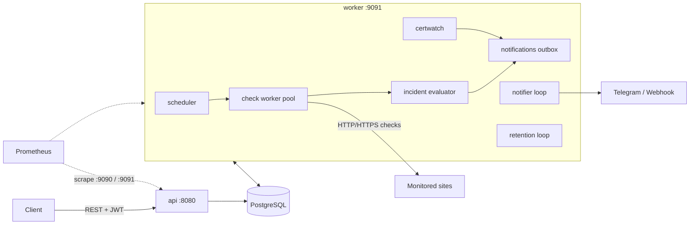

# Uptime Monitor — ТЗ для AI-ассистента (SRE-версия)

> **Как использовать.** Положи файл в корень пустого репозитория `uptime-monitor` как `PROMPT.md` и передай его AI-ассистенту для кодинга (Claude Code или любому аналогу, который работает с репозиторием и терминалом):
> «Прочитай PROMPT.md полностью и начни с Фазы 0».
> После Фазы 0 попроси создать `CLAUDE.md` (или аналогичный файл контекста) с выжимкой разделов 2, 3 и 13.
>
> Это **первый из двух репозиториев**. Второй — `uptime-infra` (Terraform, Ansible, стек наблюдаемости, деплой, бэкапы, хаос-эксперименты) — описан в `uptime-infra-prompt.md`. Контракт между ними зафиксирован в разделе 3.

---

## 1. Роль, цель и контекст

Ты — senior Go-разработчик с SRE-мышлением и наставник. Вместе со мной ты строишь **Uptime Monitor**: self-hosted сервис мониторинга доступности сайтов (аналог UptimeRobot) с уведомлениями.

**Зачем.** Я иду в SRE и изучаю **Go, SQL (PostgreSQL), Docker, HTTP/HTTPS, IaC, Git, CI/CD**. Этот репозиторий — *приложение-нагрузка*: оно должно быть написано так, чтобы им было удобно **эксплуатировать**: метрики, health-пробы, структурные логи, graceful shutdown, обратно совместимые миграции, воспроизводимая сборка. Всё, что касается серверов, мониторинга, алертов, деплоя и бэкапов, живёт в `uptime-infra`.

**Как ты работаешь со мной.**
- Я учусь. В конце каждой фазы дай краткое объяснение ключевых решений (5–10 строк) и назови 2–3 места в коде, которые мне стоит разобрать самому.
- Не пиши «магию». Для неочевидных конструкций (`errgroup`, `SKIP LOCKED`, `Dialer.Control`, `httptrace`) оставляй короткий комментарий, зачем они нужны.
- Если требование неоднозначно, выбери самый простой разумный вариант и запиши в `docs/decisions.md` (контекст → решение → альтернативы). Спрашивай меня, только если выбор меняет архитектуру.

---

## 2. Правила работы (обязательные)

1. **Работай по фазам** из раздела 14. Не переходи к следующей, пока не выполнен Definition of Done текущей.
2. **В начале фазы** выведи короткий план (5–10 строк). **В конце** запусти `make lint test`, покажи результат, перечисли коммиты и **остановись, дождавшись моего подтверждения**.
3. **Git.** Фаза = ветка `feat/phase-N-<slug>` от `main`. Коммиты маленькие, формат [Conventional Commits](https://www.conventionalcommits.org/) на английском. Коммить локально. **Не делай `git push`, не создавай PR и не используй `--force` без моей команды.**
4. **Никаких секретов в репозитории.** Только `.env.example` с безопасными заглушками; `.env` в `.gitignore`.
5. **Зависимости.** Приоритет — стандартная библиотека. Перед добавлением новой библиотеки одной строкой объясни зачем. Проверяй актуальные версии (не полагайся на память).
6. **Тесты пишутся вместе с кодом.** Код без тестов в фазе не считается готовым.
7. **Язык.** Код, комментарии, коммиты, README, OpenAPI — на английском. Общение со мной — на русском.
8. **Метрики — часть функциональности.** Новый компонент (цикл, очередь, внешний вызов) без метрик из раздела 10 не считается законченным.
9. **Миграции только обратно совместимые** (подход expand/contract): новая схема обязана работать со **старой** версией приложения, иначе откат релиза невозможен. Деструктивные изменения (drop column) — отдельным релизом после того, как старый код ушёл.
10. Не используй тег `latest` в Dockerfile/compose для базовых образов — только конкретные версии.

---

## 3. Контракт с `uptime-infra`

Этот раздел — «API эксплуатации». Его нельзя менять без синхронного обновления `uptime-infra`.

| Область | Контракт |
|---|---|
| **Образ** | `ghcr.io/<username>/uptime-monitor:<semver>` (без `v`, например `1.2.0`) + `sha-<commit>`. Один образ, три бинарника: `/app/api`, `/app/worker`, `/app/migrate`. Платформы: `linux/amd64`, `linux/arm64`. |
| **Порты** | `api`: `8080` (публичный REST API) и `9090` (ops: `/metrics`, опционально `/debug/pprof`). `worker`: `9091` (ops: `/healthz`, `/readyz`, `/metrics`). Ops-порты **не публикуются наружу**, их скрейпит Prometheus из внутренней сети. |
| **Liveness** | `GET /healthz` — процесс жив, **БД не проверяет**. |
| **Readiness** | `GET /readyz` — БД доступна. У worker дополнительно: сердцебиение планировщика свежее 30 с. |
| **Healthcheck в контейнере** | Флаг `-healthcheck` у `api` и `worker` (делает запрос на localhost и завершается с кодом 0/1), т.к. в distroless нет curl. |
| **Логи** | JSON в stdout, поля: `time`, `level`, `msg`, `service` (`api`/`worker`), `version`, `request_id`, а также `monitor_id`/`incident_id` где применимо. Никаких секретов. |
| **Метрики** | Prometheus, каталог — раздел 10 и `docs/metrics.md`. Имена и лейблы — публичный контракт. |
| **Миграции** | Отдельный бинарник `/app/migrate up` запускается **до** старта новой версии. Миграции обратно совместимы (правило 9). |
| **Остановка** | `SIGTERM` → graceful shutdown. `SHUTDOWN_TIMEOUT` по умолчанию `25s` (меньше `stop_grace_period: 30s` в compose). |
| **Конфигурация** | Только переменные окружения (раздел 12). |
| **Масштабирование** | `api` stateless, N реплик допустимо (rate limiter in-memory — известное ограничение, зафиксировать в `docs/decisions.md`). `worker`: **N реплик безопасно** благодаря `SKIP LOCKED` — это свойство нужно для blue/green и деплоя без простоя. |
| **Версия** | `GET /version` → `{"version","commit","built_at"}`; метрика `uptime_build_info`. Версии — SemVer, теги `vX.Y.Z`. |

---

## 4. Технологический стек (зафиксирован)

| Область | Решение |
|---|---|
| Язык | Go — последняя стабильная версия (проверь `go version`, минимум 1.23) |
| HTTP-роутер | `github.com/go-chi/chi/v5` |
| БД | PostgreSQL 16, `github.com/jackc/pgx/v5` (`pgxpool`). **Без ORM и без sqlc** — чистый SQL, чтобы я тренировал SQL |
| Миграции | `github.com/pressly/goose/v3`, SQL-файлы, `embed`; запуск через `pgx/v5/stdlib` |
| Конфигурация | env, `github.com/caarlos0/env/v11` |
| Логи | стандартный `log/slog` (JSON в prod, text в dev) |
| Метрики | `github.com/prometheus/client_golang` |
| Валидация | `github.com/go-playground/validator/v10` |
| Auth | `golang.org/x/crypto/bcrypt`, `github.com/golang-jwt/jwt/v5` |
| Конкурентность | `context`, `golang.org/x/sync/errgroup` |
| Rate limit | `golang.org/x/time/rate` (in-memory) |
| Тесты | `testing`, `testify`, `httptest`, `testcontainers-go` (модуль postgres) |
| Линтер | `golangci-lint` |
| Контейнеры | Docker (multi-stage, distroless, non-root), Docker Compose |
| CI/CD | GitHub Actions, образы в `ghcr.io` |

Redis не используем: очереди и планирование — на PostgreSQL (`FOR UPDATE SKIP LOCKED`).

---

## 5. Функциональные требования

### 5.1. Пользователи и аутентификация
- Регистрация по email + пароль (≥ 8 символов, bcrypt).
- Логин возвращает **access JWT** (`ACCESS_TOKEN_TTL`, по умолчанию 12 ч). Refresh-токены вынесены в stretch (раздел 17) — для SRE-проекта это не приоритет.
- Rate limit на `/auth/*` (10 запросов/мин на IP).

### 5.2. Мониторы
CRUD мониторов пользователя.

| Поле | Правила |
|---|---|
| `name` | 1–100 символов |
| `url` | `http`/`https`, валидный URL, прошёл SSRF-проверку (раздел 11) |
| `method` | `GET` или `HEAD`, по умолчанию `GET` |
| `interval_seconds` | 30–86400, по умолчанию 60 |
| `timeout_seconds` | 1–30, по умолчанию 10 |
| `expected_status` | необязательный; `null` → любой 2xx |
| `keyword` | необязательный; тело (первые 1 МБ) должно содержать подстроку |
| `follow_redirects` | по умолчанию `true`, максимум 5 редиректов |
| `failure_threshold` | подряд неудач до открытия инцидента, 1–10, по умолчанию 3 |
| `cert_expiry_warn_days` | за сколько дней предупреждать об истечении TLS-сертификата, 1–90, по умолчанию 14 |
| `is_active` | пауза/возобновление |

Лимит: `MAX_MONITORS_PER_USER` (по умолчанию 20).

### 5.3. Проверки (HTTP/HTTPS-диагностика)
Каждая проверка записывает **разбивку по фазам** (через `net/http/httptrace`) — это и есть «HTTP/HTTPS в действии»:
- `dns_ms`, `connect_ms`, `tls_ms`, `ttfb_ms`, общее `response_time_ms`;
- `status_code`, `http_proto` (`HTTP/1.1` / `HTTP/2.0`);
- для HTTPS: `tls_version` (`TLS1.2`/`TLS1.3`) и `tls_not_after` (срок действия leaf-сертификата).

Клиент создаётся с `DisableKeepAlives: true`, чтобы каждая проверка измеряла полный цикл (DNS → TCP → TLS → запрос).

Типы ошибок (`error_kind`, закрытый перечень): `dns`, `timeout`, `connection`, `tls`, `unexpected_status`, `keyword_mismatch`, `blocked_target`, `unknown`.

История проверок доступна через API. Фоновая очистка: старше `CHECKS_RETENTION_DAYS` (30) удаляются.

### 5.4. Статистика
`GET /api/v1/monitors/{id}/stats?period=24h|7d|30d` → `uptime_percent`, `avg_response_ms`, `p95_response_ms`, `p95_ttfb_ms`, `total_checks`, `failed_checks`. Считается **SQL-запросом** (`percentile_cont`), не в Go.

### 5.4a. Предупреждения об истечении сертификата
Цикл `certwatch` в worker раз в час находит активные мониторы, у которых `tls_not_after < now() + cert_expiry_warn_days` и по этому значению `tls_not_after` предупреждение ещё не отправлялось (`cert_alerted_for IS DISTINCT FROM tls_not_after`), и в одной транзакции создаёт записи в outbox (`event = 'cert_expiring'`) и обновляет `cert_alerted_for`. После продления сертификата `tls_not_after` меняется, и цикл предупреждений начинается заново.

### 5.5. Инциденты
- `consecutive_failures >= failure_threshold` и открытого инцидента нет → **открыть инцидент**.
- Первая успешная проверка при открытом инциденте → **закрыть** (`resolved_at`).
- Не более одного открытого инцидента на монитор (частичный уникальный индекс).
- Статус монитора: `unknown` → `up` / `down`.

### 5.6. Каналы и доставка уведомлений
- Каналы: **Telegram** (Bot API, `chat_id` в конфиге канала, токен бота в env) и **Webhook** (POST JSON, `X-Signature: sha256=<HMAC>` секретом канала).
- Уведомления идут на все активные каналы владельца монитора.
- События: `incident_opened`, `incident_resolved`, `cert_expiring`.
- **Outbox:** запись в `notifications` создаётся в той же транзакции, что и изменение инцидента. Отдельный цикл берёт `pending` (`SKIP LOCKED`), отправляет, при ошибке — экспоненциальный backoff, максимум 5 попыток, затем `failed`.

---

## 6. Архитектура

Один репозиторий, один образ, **три бинарника**:

| Бинарник | Назначение |
|---|---|
| `cmd/api` | HTTP API (порт 8080) + ops-сервер (порт 9090) |
| `cmd/worker` | Планировщик, пул проверок, оценка инцидентов, certwatch, outbox-доставка, retention; ops-сервер (порт 9091) |
| `cmd/migrate` | Применение миграций (goose) |



**Слои:** `handler (httpapi)` → `service` → `repository (postgres)`; `domain` ни от чего не зависит. Интерфейсы объявляются на стороне потребителя.

**Планировщик.** Каждые ~1–2 с worker выбирает просроченные мониторы и сразу сдвигает `next_check_at`, чтобы несколько экземпляров не брали одну работу:

```sql
UPDATE monitors
SET next_check_at = now() + make_interval(secs => interval_seconds)
WHERE id IN (
    SELECT id FROM monitors
    WHERE is_active AND next_check_at <= now()
    ORDER BY next_check_at
    LIMIT $1
    FOR UPDATE SKIP LOCKED
)
RETURNING id, url, method, timeout_seconds, expected_status, keyword,
          follow_redirects, failure_threshold, next_check_at AS scheduled_for;
```

Для метрики `uptime_scheduler_lag_seconds` нужно сохранить **плановое** время проверки (`scheduled_for` — значение `next_check_at` *до* сдвига; для этого используй CTE, возвращающую старое значение) и сравнить его с фактическим стартом проверки.

Результат проверки сохраняется, затем в **одной транзакции**: обновляются `consecutive_failures`/`status`/`tls_not_after` монитора, открывается/закрывается инцидент, создаются записи в `notifications`.

**Graceful shutdown.** По `SIGTERM`: перестать брать новую работу, дождаться текущих проверок (до `SHUTDOWN_TIMEOUT`), закрыть пул. Все циклы запускаются через `errgroup` с общим `context`.

---

## 7. Структура репозитория

```
uptime-monitor/
├── cmd/
│   ├── api/main.go
│   ├── worker/main.go
│   └── migrate/main.go
├── internal/
│   ├── config/                 # env-конфигурация + валидация при старте
│   ├── domain/                 # сущности и доменные ошибки
│   ├── platform/
│   │   ├── logger/             # slog
│   │   ├── postgres/           # pgxpool, WithTx
│   │   └── ops/                # ops-HTTP-сервер: /metrics, /healthz, /readyz, pprof
│   ├── observability/          # реестр метрик, middleware, collectors, build info
│   ├── auth/                   # JWT, bcrypt
│   ├── service/                # бизнес-логика
│   ├── repository/postgres/    # SQL
│   ├── httpapi/
│   │   ├── router.go
│   │   ├── handler/
│   │   ├── middleware/         # request id, logging, recover, metrics, auth, rate limit, body limit
│   │   └── response/
│   ├── checker/                # HTTP-клиент: httptrace, safe dialer (SSRF), классификация ошибок
│   ├── scheduler/              # due-мониторы + пул воркеров
│   ├── certwatch/              # предупреждения об истечении сертификатов
│   ├── notifier/               # outbox-цикл, Telegram, Webhook, ретраи
│   └── retention/
├── migrations/                 # NNNN_name.sql
├── api/openapi.yaml
├── docs/
│   ├── architecture.md
│   ├── decisions.md
│   └── metrics.md              # каталог метрик (контракт с uptime-infra)
├── scripts/
│   └── smoke.sh                # регистрация → создание монитора → ожидание проверки
├── .github/
│   ├── workflows/{ci.yml,release.yml}
│   ├── dependabot.yml
│   └── pull_request_template.md
├── Dockerfile
├── docker-compose.yml          # app + postgres: запуск одной командой
├── Makefile
├── .golangci.yml
├── .env.example
├── .gitignore
├── .dockerignore
├── LICENSE                     # MIT
├── CLAUDE.md
└── README.md
```

Module path: `github.com/<MY_GITHUB_USERNAME>/uptime-monitor` — спроси username в Фазе 0.

---

## 8. Схема базы данных

Миграции — goose-файлы (`-- +goose Up` / `-- +goose Down`). Разбей по фазам.

```sql
CREATE TABLE users (
    id            UUID PRIMARY KEY DEFAULT gen_random_uuid(),
    email         TEXT NOT NULL UNIQUE,
    password_hash TEXT NOT NULL,
    created_at    TIMESTAMPTZ NOT NULL DEFAULT now()
);

CREATE TABLE monitors (
    id                    UUID PRIMARY KEY DEFAULT gen_random_uuid(),
    user_id               UUID NOT NULL REFERENCES users(id) ON DELETE CASCADE,
    name                  TEXT NOT NULL,
    url                   TEXT NOT NULL,
    method                TEXT NOT NULL DEFAULT 'GET' CHECK (method IN ('GET','HEAD')),
    interval_seconds      INT  NOT NULL DEFAULT 60 CHECK (interval_seconds BETWEEN 30 AND 86400),
    timeout_seconds       INT  NOT NULL DEFAULT 10 CHECK (timeout_seconds BETWEEN 1 AND 30),
    expected_status       INT,
    keyword               TEXT,
    follow_redirects      BOOLEAN NOT NULL DEFAULT TRUE,
    failure_threshold     INT  NOT NULL DEFAULT 3 CHECK (failure_threshold BETWEEN 1 AND 10),
    cert_expiry_warn_days INT  NOT NULL DEFAULT 14 CHECK (cert_expiry_warn_days BETWEEN 1 AND 90),
    is_active             BOOLEAN NOT NULL DEFAULT TRUE,
    status                TEXT NOT NULL DEFAULT 'unknown' CHECK (status IN ('unknown','up','down')),
    consecutive_failures  INT  NOT NULL DEFAULT 0,
    tls_not_after         TIMESTAMPTZ,            -- последний увиденный срок сертификата
    cert_alerted_for      TIMESTAMPTZ,            -- для какого tls_not_after уже отправлено предупреждение
    next_check_at         TIMESTAMPTZ NOT NULL DEFAULT now(),
    last_checked_at       TIMESTAMPTZ,
    created_at            TIMESTAMPTZ NOT NULL DEFAULT now(),
    updated_at            TIMESTAMPTZ NOT NULL DEFAULT now()
);
CREATE INDEX idx_monitors_user ON monitors(user_id);
CREATE INDEX idx_monitors_due  ON monitors(next_check_at) WHERE is_active;

CREATE TABLE checks (
    id               BIGINT GENERATED ALWAYS AS IDENTITY PRIMARY KEY,
    monitor_id       UUID NOT NULL REFERENCES monitors(id) ON DELETE CASCADE,
    checked_at       TIMESTAMPTZ NOT NULL DEFAULT now(),
    success          BOOLEAN NOT NULL,
    status_code      INT,
    response_time_ms INT NOT NULL,
    dns_ms           INT,
    connect_ms       INT,
    tls_ms           INT,
    ttfb_ms          INT,
    http_proto       TEXT,                        -- 'HTTP/1.1', 'HTTP/2.0'
    tls_version      TEXT,                        -- 'TLS1.2', 'TLS1.3'
    tls_not_after    TIMESTAMPTZ,
    error_kind       TEXT,
    error_message    TEXT
);
CREATE INDEX idx_checks_monitor_time ON checks(monitor_id, checked_at DESC);
CREATE INDEX idx_checks_checked_at   ON checks(checked_at);   -- retention

CREATE TABLE incidents (
    id          UUID PRIMARY KEY DEFAULT gen_random_uuid(),
    monitor_id  UUID NOT NULL REFERENCES monitors(id) ON DELETE CASCADE,
    started_at  TIMESTAMPTZ NOT NULL DEFAULT now(),
    resolved_at TIMESTAMPTZ,
    cause_kind  TEXT
);
CREATE UNIQUE INDEX uniq_open_incident_per_monitor ON incidents(monitor_id) WHERE resolved_at IS NULL;
CREATE INDEX idx_incidents_monitor ON incidents(monitor_id, started_at DESC);

CREATE TABLE notification_channels (
    id         UUID PRIMARY KEY DEFAULT gen_random_uuid(),
    user_id    UUID NOT NULL REFERENCES users(id) ON DELETE CASCADE,
    type       TEXT NOT NULL CHECK (type IN ('telegram','webhook')),
    name       TEXT NOT NULL,
    config     JSONB NOT NULL,     -- telegram: {"chat_id": "..."}; webhook: {"url": "...", "secret": "..."}
    is_active  BOOLEAN NOT NULL DEFAULT TRUE,
    created_at TIMESTAMPTZ NOT NULL DEFAULT now()
);

CREATE TABLE notifications (       -- outbox
    id              BIGINT GENERATED ALWAYS AS IDENTITY PRIMARY KEY,
    monitor_id      UUID NOT NULL REFERENCES monitors(id) ON DELETE CASCADE,
    incident_id     UUID REFERENCES incidents(id) ON DELETE CASCADE,   -- NULL для cert_expiring
    channel_id      UUID NOT NULL REFERENCES notification_channels(id) ON DELETE CASCADE,
    event           TEXT NOT NULL CHECK (event IN ('incident_opened','incident_resolved','cert_expiring')),
    status          TEXT NOT NULL DEFAULT 'pending' CHECK (status IN ('pending','sent','failed')),
    attempts        INT  NOT NULL DEFAULT 0,
    next_attempt_at TIMESTAMPTZ NOT NULL DEFAULT now(),
    last_error      TEXT,
    created_at      TIMESTAMPTZ NOT NULL DEFAULT now(),
    sent_at         TIMESTAMPTZ
);
CREATE INDEX idx_notifications_pending ON notifications(next_attempt_at) WHERE status = 'pending';
```

**Изоляция данных:** каждый API-запрос к `monitors`, `incidents`, `checks`, `notification_channels` фильтрует по `user_id` владельца (прямо или через JOIN). Для этого есть отдельные тесты «чужой ресурс → 404».

---

## 9. REST API (`/api/v1`)

Единый формат ошибок:

```json
{ "error": { "code": "validation_failed", "message": "Invalid request", "details": [{"field": "url", "issue": "must be http or https"}] } }
```

Коды: `validation_failed` (400), `unauthorized` (401), `not_found` (404), `conflict` (409), `rate_limited` (429), `internal` (500). Внутренние ошибки наружу не раскрываются, пишутся в лог с `request_id`.

Пагинация: `?limit=` (по умолчанию 50, максимум 200), `?offset=`; ответ `{"items": [...], "total": N}`.

| Метод | Путь | Описание | Auth |
|---|---|---|---|
| GET | `/healthz` | liveness (без БД) | — |
| GET | `/readyz` | readiness (проверка БД) | — |
| GET | `/version` | версия, коммит, время сборки | — |
| POST | `/api/v1/auth/register` | регистрация | — |
| POST | `/api/v1/auth/login` | вход → access JWT | — |
| GET | `/api/v1/me` | текущий пользователь | ✔ |
| POST | `/api/v1/monitors` | создать монитор | ✔ |
| GET | `/api/v1/monitors` | список | ✔ |
| GET | `/api/v1/monitors/{id}` | один монитор | ✔ |
| PATCH | `/api/v1/monitors/{id}` | частичное обновление (в т.ч. пауза) | ✔ |
| DELETE | `/api/v1/monitors/{id}` | удалить | ✔ |
| GET | `/api/v1/monitors/{id}/checks` | история (`?from=&to=`) | ✔ |
| GET | `/api/v1/monitors/{id}/stats` | статистика (`?period=24h\|7d\|30d`) | ✔ |
| GET | `/api/v1/incidents` | инциденты (`?monitor_id=&open=true`) | ✔ |
| GET | `/api/v1/incidents/{id}` | один инцидент | ✔ |
| POST | `/api/v1/channels` | создать канал | ✔ |
| GET | `/api/v1/channels` | список | ✔ |
| PATCH | `/api/v1/channels/{id}` | обновить/выключить | ✔ |
| DELETE | `/api/v1/channels/{id}` | удалить | ✔ |
| POST | `/api/v1/channels/{id}/test` | тестовое уведомление | ✔ |

Middleware (порядок): request id → recover → **metrics** → logging → лимит тела (1 МБ) → CORS → auth → rate limit (`/auth/*`).

`http.Server`: обязательны `ReadHeaderTimeout`, `ReadTimeout`, `WriteTimeout`, `IdleTimeout`.

Спецификация — `api/openapi.yaml`, поддерживается вручную.

---

## 10. Наблюдаемость (ядро SRE-части)

### 10.1. Метрики Prometheus
Префикс `uptime_`. Соблюдай [naming best practices](https://prometheus.io/docs/practices/naming/): базовые единицы (секунды, байты), суффикс `_total` у счётчиков, `_seconds` у времени.

**Золотое правило кардинальности:** в лейблах **запрещены** `monitor_id`, `user_id`, `url`, `request_id`, любые значения из пользовательского ввода. Допустимы только закрытые перечни. Для HTTP-метрик лейбл `route` — **шаблон маршрута chi** (`/api/v1/monitors/{id}`), для несовпавших маршрутов — константа `unmatched`. Это проверяется тестом.

| Метрика | Тип | Лейблы | Смысл / SLI |
|---|---|---|---|
| `uptime_http_requests_total` | counter | `method`, `route`, `code` | основа SLI доступности API (исключая `/healthz`, `/readyz`) |
| `uptime_http_request_duration_seconds` | histogram | `method`, `route` | SLI задержки. Бакеты: 0.005, 0.01, 0.025, 0.05, 0.1, 0.25, 0.5, 1, 2.5, 5 |
| `uptime_http_requests_in_flight` | gauge | — | нагрузка на API |
| `uptime_checks_total` | counter | `result` (`success`/`failure`), `error_kind` | объём и качество проверок |
| `uptime_check_duration_seconds` | histogram | — | длительность запросов к целям. Бакеты: 0.05, 0.1, 0.25, 0.5, 1, 2.5, 5, 10, 30 |
| `uptime_scheduler_lag_seconds` | histogram | — | задержка старта проверки относительно плана (**SLI своевременности**). Бакеты: 0.5, 1, 2, 5, 10, 30, 60 |
| `uptime_scheduler_due_monitors` | gauge | — | сколько мониторов было просрочено на последнем тике (бэклог) |
| `uptime_worker_pool_busy` / `uptime_worker_pool_size` | gauge | — | насыщение пула |
| `uptime_notifications_total` | counter | `channel_type`, `status` (`sent`/`retry`/`failed`) | исходы доставки |
| `uptime_notification_delivery_delay_seconds` | histogram | `channel_type` | `sent_at − created_at` (**SLI доставки**). Бакеты: 1, 5, 15, 30, 60, 120, 300, 900 |
| `uptime_notifications_pending` | gauge | — | размер outbox |
| `uptime_notification_oldest_pending_age_seconds` | gauge | — | возраст самой старой неотправленной записи |
| `uptime_incidents_open` | gauge | — | открытые инциденты |
| `uptime_incidents_opened_total` | counter | — | поток инцидентов |
| `uptime_monitors` | gauge | `state` (`active`/`paused`) | размер системы |
| `uptime_monitors_cert_expiring` | gauge | — | число мониторов с истекающим сертификатом |
| `uptime_retention_deleted_rows_total` | counter | — | работа очистки |
| `uptime_retention_last_success_timestamp_seconds` | gauge | — | свежесть очистки |
| `uptime_db_pool_*` | gauge | — | из `pgxpool.Stat()`: acquired, idle, total, max, acquire-wait |
| `uptime_build_info` | gauge (=1) | `version`, `commit`, `go_version` | какая версия работает |

Плюс стандартные `go_*` и `process_*`. Gauge-метрики, требующие запроса в БД (`due_monitors`, `notifications_pending`, `incidents_open`, `monitors`, `cert_expiring`), обновляются фоновой горутиной раз в 15 с с таймаутом запроса; ошибка обновления логируется и не роняет сервис.

Каталог с описанием каждой метрики, лейблов и того, для какого SLI/алерта она нужна, ведётся в `docs/metrics.md`.

### 10.2. Ops-серверы
- `api`: второй `http.Server` на `OPS_ADDR` (`:9090`): `/metrics`, а при `PPROF_ENABLED=true` — `/debug/pprof/*`. Публичный роутер `/metrics` **не отдаёт**.
- `worker`: `:9091` — `/metrics`, `/healthz`, `/readyz`.
- Ops-серверы тоже останавливаются gracefully.

### 10.3. Логи
`slog` JSON; единый набор полей (раздел 3); уровень из `LOG_LEVEL`. Request id генерируется middleware, пробрасывается в контекст и ответ (`X-Request-Id`). Логи доступа не пишут тела запросов, заголовки `Authorization`, пароли и секреты каналов.

### 10.4. Сборка и версия
`version`, `commit`, `built_at` внедряются через `-ldflags`; выводятся в `/version`, `-version` и `uptime_build_info`.

---

## 11. Безопасность

- **SSRF-защита в `internal/checker`** (критично: сервис ходит по URL пользователя):
  - по умолчанию запрещены loopback, private (RFC 1918), link-local (включая `169.254.169.254`), CGNAT, multicast, unspecified, IPv6 ULA/link-local;
  - проверка — **на уровне подключения** через `net.Dialer.Control` (после DNS-резолва, защита от DNS rebinding) и на каждом редиректе;
  - только схемы `http`/`https`;
  - `ALLOW_PRIVATE_TARGETS=true` — только для dev (по умолчанию `false`), с предупреждением в README.
- Валидация секретов при старте: `JWT_SECRET` ≥ 32 байт, иначе приложение не стартует.
- bcrypt (cost ≥ 10); одинаковый ответ для «нет пользователя» и «неверный пароль».
- Секреты каналов и токены не попадают в логи и ответы API (секрет вебхука показывается только при создании).
- Все SQL параметризованы.
- Тело запроса ограничено 1 МБ; тело ответа цели читается не более 1 МБ.
- Контейнер: non-root, distroless, без shell.
- CI: `govulncheck`, `hadolint`, `trivy` по образу, Dependabot (gomod, github-actions, docker).

---

## 12. Конфигурация (`.env.example`)

| Переменная | Назначение | По умолчанию |
|---|---|---|
| `APP_ENV` | `dev` / `prod` (формат логов) | `dev` |
| `LOG_LEVEL` | `debug`/`info`/`warn`/`error` | `info` |
| `HTTP_ADDR` | публичный API | `:8080` |
| `OPS_ADDR` | ops-сервер (`api`: 9090, `worker`: 9091) | см. раздел 3 |
| `PPROF_ENABLED` | включить pprof на ops-порту | `false` |
| `DATABASE_URL` | строка подключения | — (обязательна) |
| `DB_MAX_CONNS` | максимум соединений в пуле | `10` |
| `JWT_SECRET` | ≥ 32 байт | — (обязательна) |
| `ACCESS_TOKEN_TTL` | время жизни access-токена | `12h` |
| `CORS_ALLOWED_ORIGINS` | список через запятую | пусто |
| `MAX_MONITORS_PER_USER` | лимит мониторов | `20` |
| `ALLOW_PRIVATE_TARGETS` | private IP (только dev) | `false` |
| `WORKER_CONCURRENCY` | размер пула проверок | `20` |
| `SCHEDULER_BATCH_SIZE` | мониторов за тик | `50` |
| `CHECKS_RETENTION_DAYS` | срок хранения проверок | `30` |
| `SHUTDOWN_TIMEOUT` | graceful shutdown | `25s` |
| `TELEGRAM_BOT_TOKEN` | токен бота (пусто → Telegram выключен) | пусто |

---

## 13. Качество кода и тестирование

- `gofmt`/`goimports`. Линтеры: `errcheck`, `govet`, `staticcheck`, `revive`, `gosec`, `errorlint`, `bodyclose`, `sqlclosecheck`, `noctx`, `gocritic`, `unused`, `ineffassign` (конфиг под установленную версию golangci-lint).
- Ошибки: `fmt.Errorf("...: %w", err)`, `errors.Is/As`; доменные ошибки мапятся на HTTP-коды **в одном месте**.
- `context.Context` первым аргументом во всех функциях с I/O.
- Без глобального состояния и `init()`; зависимости через конструкторы (реестр метрик тоже внедряется, а не глобальный default registry).
- Без `panic` в рабочем коде; у каждой горутины есть условие остановки.
- Время через внедряемый `Clock` для детерминированных тестов.
- Без `fmt.Println`; только `slog`.

**Тесты**
- Unit: table-driven, `-race`.
- `checker`: `httptest.Server` (200, 500, таймаут, редирект, keyword, блокировка private IP, DNS rebinding через кастомный резолвер); проверка заполнения `dns_ms/connect_ms/tls_ms/ttfb_ms` на `httptest.NewTLSServer`; классификация ошибок (в т.ч. просроченный/самоподписанный сертификат → `tls`).
- `service`: fake-репозитории (пороги, открытие/закрытие инцидентов, лимиты).
- Интеграционные (`testcontainers-go`, build-тег `integration`): репозитории; **конкурентный планировщик** (два потребителя не берут один монитор); outbox-ретраи; certwatch (дедупликация предупреждений).
- `httpapi`: хендлеры через `httptest`, авторизация, изоляция данных.
- `observability`: тест кардинальности (`route` = шаблон/`unmatched`), `promlint` (`testutil.GatherAndLint`) на реестре, проверка наличия всех метрик из каталога.
- Цель: покрытие `internal/service` и `internal/checker` ≥ 70 %.

**Makefile** (с `help`): `run-api`, `run-worker`, `build`, `test`, `test-integration`, `cover`, `lint`, `fmt`, `tidy`, `migrate-up`, `migrate-down`, `migrate-create name=...`, `docker-build`, `up`, `down`, `logs`, `smoke`.

---

## 14. План разработки по фазам

В каждой фазе: ветка `feat/phase-N-...`, тесты, `make lint test` зелёный, обновлённая документация.

### Фаза 0 — Каркас
- Спроси GitHub username, `git init`, `go mod init`, структура из раздела 7.
- `Makefile`, `.gitignore`, `.dockerignore`, `.golangci.yml`, `.env.example`, `LICENSE`, README-скелет.
- `internal/config`, `internal/platform/logger`.
- `cmd/api`: chi, `/healthz`, `/version`, graceful shutdown; флаг `-healthcheck`.
- **Минимальный CI** (`ci.yml`): build, golangci-lint, `go test ./...`.
- **DoD:** `make run-api` отвечает на `/healthz`; `make lint test` зелёный; осмысленные коммиты.

### Фаза 1 — БД и миграции
- Postgres 16 в compose (healthcheck), `internal/platform/postgres`, `cmd/migrate`, миграция users.
- Тестовая обвязка testcontainers; `/readyz` проверяет БД.
- **DoD:** `make migrate-up/down` работают; интеграционный тест применяет миграции с нуля.

### Фаза 2 — Пользователи и аутентификация
- Репозиторий, сервис, хендлеры: register, login, `/me`.
- Middleware: request id, recover, logging, лимит тела, auth, rate limit.
- **DoD:** тесты на успешные и негативные сценарии (дубликат email, неверный пароль, просроченный/битый JWT); единый формат ошибок.

### Фаза 3 — Мониторы (CRUD)
- Миграция, репозиторий, сервис, хендлеры, валидация, лимит, пагинация, синтаксическая SSRF-проверка URL.
- **DoD:** CRUD работает; тесты изоляции данных (чужой монитор → 404); `details` по полям.

### Фаза 4 — Проверки, планировщик, статистика
- `internal/checker` (httptrace-тайминги, TLS-информация, safe dialer, классификация ошибок, лимит тела, редиректы), миграция `checks`.
- `cmd/worker`: планировщик (`SKIP LOCKED`, сохранение планового времени), пул, сохранение результатов, retention-цикл, graceful shutdown.
- `/checks` и `/stats` (SQL-агрегаты).
- **DoD:** мониторы реально проверяются; в БД есть тайминги фаз и `tls_not_after`; тест конкурентного планировщика; тесты SSRF; `-race` чисто.

### Фаза 5 — Инциденты
- Миграция, транзакционная логика (`consecutive_failures`, `status`, открытие/закрытие), эндпоинты `/incidents`.
- **DoD:** table-driven тесты порогов (границы `failure_threshold`), гарантия одного открытого инцидента при конкурентных результатах.

### Фаза 6 — Уведомления и certwatch
- Миграции `notification_channels`, `notifications`; CRUD каналов; `/channels/{id}/test`.
- Notifier: outbox, `SKIP LOCKED`, backoff (5 попыток), Telegram, Webhook (HMAC).
- `certwatch`: предупреждения об истечении сертификата с дедупликацией.
- **DoD:** тесты Telegram/Webhook на `httptest`; тест ретраев и перехода в `failed`; тест дедупликации `cert_expiring`; в сообщениях нет секретов.

### Фаза 7 — Наблюдаемость
- Пакет `internal/observability`: реестр, HTTP-middleware, collectors (`pgxpool`, фоновые gauge), `uptime_build_info`.
- Инструментация всех компонентов по каталогу раздела 10.1; ops-серверы (`:9090`, `:9091`), pprof по флагу, `/readyz` worker с сердцебиением планировщика.
- `docs/metrics.md`; версия через ldflags.
- **DoD:** `curl :9090/metrics` и `curl :9091/metrics` показывают все метрики каталога; тесты кардинальности и `promlint` зелёные; метрики не доступны через публичный порт 8080; при остановке БД `/readyz` отдаёт 503, а `/healthz` — 200.

### Фаза 8 — Docker
- Multi-stage `Dockerfile` (`CGO_ENABLED=0`, `-trimpath`, `-ldflags "-s -w -X ..."`), финальный образ distroless non-root, три бинарника.
- `docker-compose.yml`: `postgres` (healthcheck) → `migrate` (`service_completed_successfully`) → `api`, `worker`; `stop_grace_period: 30s`; конфиг из `.env`.
- `scripts/smoke.sh`.
- **DoD:** `cp .env.example .env && docker compose up --build` поднимает рабочую систему; `make smoke` проходит; образ < 30 МБ; контейнеры не от root; `docker stop` завершает процессы корректно (проверь по логам shutdown).

### Фаза 9 — CI/CD
- `ci.yml`: lint, unit + integration с `-race` и покрытием, `govulncheck`, `hadolint`, сборка образа и `trivy` (падать на HIGH/CRITICAL), кэш модулей.
- `release.yml`: по тегу `vX.Y.Z` — multi-arch образ (`amd64`, `arm64`) в `ghcr.io` (теги `X.Y.Z`, `sha-...`; **без `latest` для prod**), GitHub Release с changelog.
- `dependabot.yml`, шаблон PR, бейджи в README, описание branch protection.
- **DoD:** PR запускает CI; тег `v0.1.0` публикует образ, который `uptime-infra` может развернуть.

### Фаза 10 — Документация и релиз
- Финальные `openapi.yaml`, `docs/architecture.md`, `docs/decisions.md`, `docs/metrics.md`.
- README по разделу 15, примеры `curl`.
- Релиз `v1.0.0`.
- **DoD:** чек-лист раздела 16 выполнен.

> **Порядок работы с двумя репозиториями.** Доведи этот репозиторий минимум до Фазы 9 и выпусти `v0.1.0`, прежде чем `uptime-infra` дойдёт до своей Фазы 2 (там нужен готовый образ). Фазы 0–1 `uptime-infra` можно делать параллельно.

---

## 15. Требования к README

1. Название, бейджи (CI, Go, лицензия), одно предложение «что это».
2. Возможности; диаграмма архитектуры (Mermaid).
3. **Quick start:** `cp .env.example .env && docker compose up --build` + пример регистрации и создания монитора через `curl`.
4. Таблица конфигурации.
5. Раздел «Operations»: порты, пробы, метрики (ссылка на `docs/metrics.md`), логи, как откатывать релиз и почему миграции должны быть совместимыми.
6. Раздел «Security» (SSRF-модель, `ALLOW_PRIVATE_TARGETS`).
7. Для разработчика: `make`-команды, запуск тестов, структура проекта.
8. Ссылка на репозиторий `uptime-infra` (развёртывание, SLO, алерты, runbook'и).
9. Roadmap, лицензия.

---

## 16. Глобальный Definition of Done

- [ ] `docker compose up --build` на чистой машине поднимает систему, `make smoke` проходит.
- [ ] `make lint test test-integration` зелёные, `go test -race ./...` без гонок.
- [ ] CI зелёный; тег публикует multi-arch образ в `ghcr.io`.
- [ ] Покрытие `service` и `checker` ≥ 70 %.
- [ ] Все метрики каталога реально отдаются и описаны в `docs/metrics.md`; нет лейблов с неограниченной кардинальностью.
- [ ] Пробы `/healthz` и `/readyz` ведут себя по контракту (раздел 3).
- [ ] SSRF-тесты проходят; секретов в репозитории нет.
- [ ] `openapi.yaml` соответствует API; README полный.
- [ ] История коммитов осмысленная, есть релизы с тегами.

---

## 17. Stretch-задачи (после v1.0.0)

- **AI-сводки инцидентов** (опционально). Интерфейс `Summarizer` + реализации `none`, `openai-compatible` (подходит для Ollama и многих хостингов), `anthropic`, `mock`. Правила: модель/ключ/провайдер только из env; таймаут 20 с и 2 ретрая; сбой AI никогда не блокирует алерты; дневной лимит; в промпт идут только структурированные данные (коды, типы ошибок, тайминги, URL без query), **не** тела ответов (prompt injection); тесты на `httptest`. Метрики: `uptime_ai_summaries_total{status}`.
- Refresh-токены с ротацией (хэш в БД), logout.
- Many-to-many монитор ↔ канал.
- Публичная статус-страница `GET /status/{slug}`.
- OpenTelemetry-трейсинг (Tempo в `uptime-infra`).
- **Мультирегиональные проверки:** worker в двух локациях, поле `location` в `checks`, инцидент только при падении из нескольких точек.
- Email/Slack-каналы, TCP-мониторы.

---

## 18. Первое действие

Начни с **Фазы 0**: прочитай документ целиком, задай не более 3 уточняющих вопросов (GitHub username, версия Go в системе, название репозитория, если оно другое), выведи план Фазы 0 и приступай. По завершении фазы остановись и дождись моего подтверждения.
